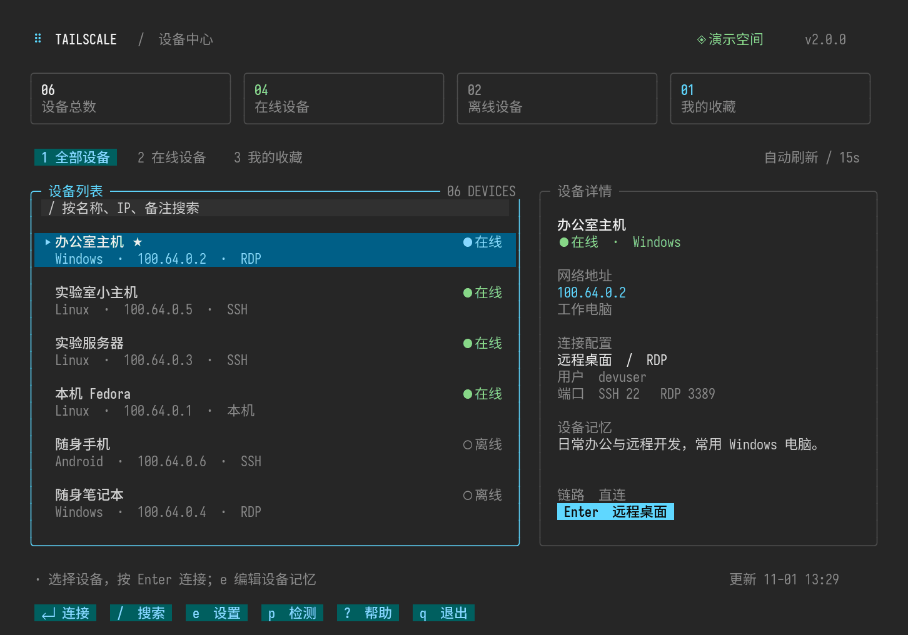
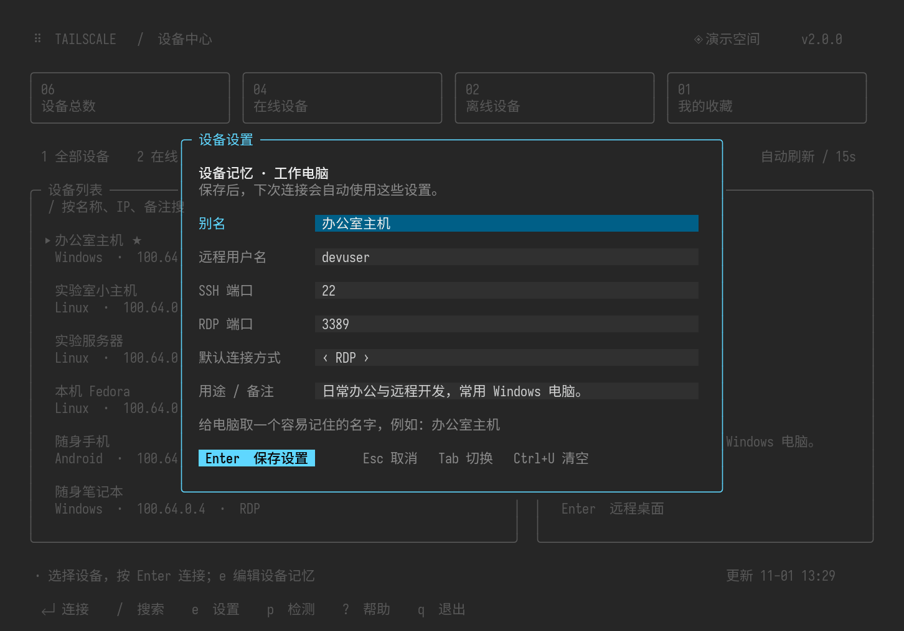
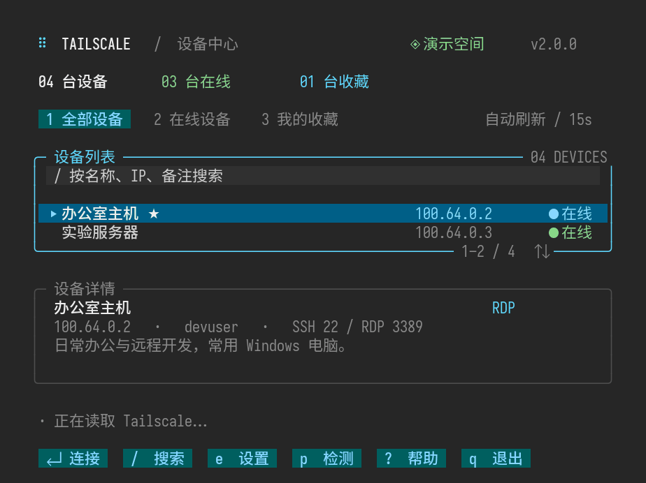

# TUI Style · 专业终端界面风格

一个可复用的 Codex Skill，把终端工具设计成清晰、美观、好操作的 TUI。

以 [lazydocker](https://github.com/jesseduffield/lazydocker) 的列表与详情分栏、[btop](https://github.com/aristocratos/btop) 的信息分区为参考，提炼出独立的设计指南。适用于新建 TUI，也适用于改造已有终端应用。

> A reusable Codex skill for polished terminal interfaces: semantic colors, master-detail layouts, Chinese text alignment, live search, modal forms, responsive sizing, and real-terminal verification. Framework agnostic; keep the stack your application already uses.



## 包含什么

- 深色主题与语义配色，支持低色彩环境回退。
- 设备或资源列表、详情分栏、概况卡片和紧凑布局。
- 中文与宽字符排版、长文本处理、焦点与输入规则。
- 即时搜索、居中设置弹窗、键盘和鼠标交互。
- 加载、空列表、离线、缓存、失败和完成等状态设计。
- 真实终端、PTY、动态缩放及数据保留的验证方法。

这是一套风格与实现指导，不绑定 Tailscale，不要求迁移框架。Python curses、Textual、Go Bubble Tea 和 Rust Ratatui 等技术栈均可采用。

## 安装到 Codex

将仓库放入个人技能目录，目录名使用 `tui-style`：

```bash
git clone https://github.com/lishuaibo-hnu/tui-style-skill.git \
  "${CODEX_HOME:-$HOME/.codex}/skills/tui-style"
```

已有同名技能时先检查内容，避免覆盖自己的版本。开启新会话后，可显式调用 `$tui-style`；技能也保留默认的自动发现方式。

## 使用示例

```text
使用 $tui-style，把这个终端设备管理器改得专业、美观一些。
保留现有功能和配置，加入列表与详情分栏、即时搜索和设置弹窗。
```

```text
用 $tui-style 给这个 Textual 应用调整视觉层次和中文排版，
同时验证 128×36、100×32、80×24 下的布局。
```

## 设置弹窗



## 紧凑布局



预览来自一个独立实现的 curses 设备管理器，展示的是演示数据；本仓库包含风格技能和图示，不包含该设备管理器的运行环境。

## 文件结构

```text
SKILL.md                       技能入口与使用范围
agents/openai.yaml             Codex 技能展示信息
references/design-system.md    配色、布局、实现和验证细节
assets/                        演示预览图
```

## 参考

- [lazydocker](https://github.com/jesseduffield/lazydocker)
- [btop](https://github.com/aristocratos/btop)
- [Textual](https://github.com/Textualize/textual)

风格指南与图示独立整理，未复制上述项目的代码或素材。
